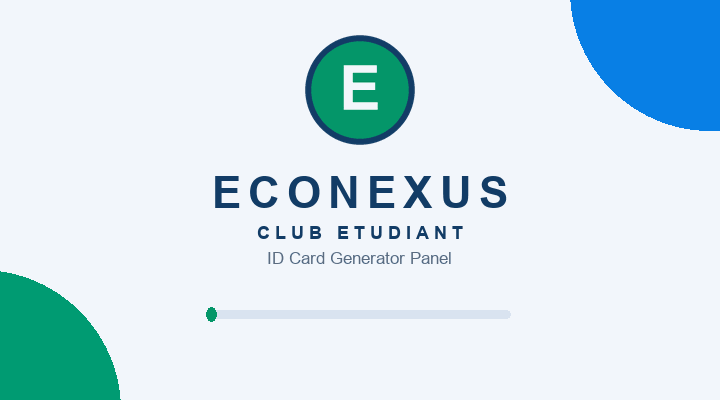

<p align="center">
  
</p>

<p align="center">
  
  
  
  
  
</p>

Panneau cross-platform (Web & Mobile) de génération de cartes ID horizontales
**CR80 (85,6 mm × 54 mm)** pour le club étudiant **ECONEXUS** :
connexion par **passkey uniquement**, sauvegarde en base **Supabase**,
tableau des membres avec réédition PDF, modification, suppression et
planche A4.

<p align="center">
  
</p>

---

## Sommaire

- [Fonctionnalités](#fonctionnalités)
- [Démarrage rapide](#démarrage-rapide)
- [Base de données (copier-coller Supabase)](#base-de-données-copier-coller-supabase)
- [Passkeys & noms des propriétaires](#passkeys--noms-des-propriétaires)
- [Logo du club](#logo-du-club)
- [Suppression d'arrière-plan (IA gratuite)](#suppression-darrière-plan-ia-gratuite)
- [Structure du projet](#structure-du-projet)
- [Scripts](#scripts)
- [Dépannage](#dépannage)

---

## Fonctionnalités

| Module | Détails |
|---|---|
| **Écran de lancement** | Logo + nom du club animés, ligne de chargement, puis redirection passkey ou dashboard |
| **Connexion passkey** | Ni e-mail, ni identifiant — vérifié contre `access_passkeys` (`is_active = true`), session persistée, garde de routes Expo Router |
| **Studio cartes ID** | Formulaire (prénom, nom, rôle, badge, année, photo), aperçu CR80 en direct, logo du club intégré |
| **Photo** | Galerie + éditeur de recadrage 3:4 intégré sur le Web (glisser + zoom), compression automatique si l'image est trop lourde |
| **Fond supprimé (IA)** | Après chaque photo sur le Web : détourage automatique avec barre de progression, 100 % local, gratuit et illimité |
| **PDF CR80** | `@page 85,6 mm × 54 mm paysage`, téléchargement/partage natif, impression navigateur sur le Web |
| **Tableau membres** | Recherche, vignettes, **PDF**, **Modifier** (recharge l'éditeur), **Supprimer**, planche **A4** (8 cartes/page, pointillés de découpe) |
| **Prénom/Nom auto** | Le propriétaire du passkey voit ses champs pré-remplis à la connexion |
| **Hors-ligne** | Repli local AsyncStorage si Supabase est injoignable ou non configuré |

---

## Démarrage rapide

```bash
npm install
npx expo start          # « w » pour le Web, QR code pour mobile
```

Nécessite Node.js ≥ 22.13. Le fichier `.env` est déjà renseigné avec le
projet Supabase (voir `.env.example` pour le modèle) :

```
EXPO_PUBLIC_SUPABASE_URL=https://votre-projet.supabase.co
EXPO_PUBLIC_SUPABASE_ANON_KEY=sb_publishable_...
```

> La clé `sb_publishable_…` équivaut à la clé ANON publique : elle est faite
> pour être exposée dans l'app. En revanche, **ne mettez jamais la
> `sb_secret_…` dans l'application** (usage serveur uniquement).

---

## Base de données (copier-coller Supabase)

1. Ouvrez https://supabase.com/dashboard → votre projet.
2. **SQL Editor → New query**.
3. Copiez-collez **tout** le fichier `schema.sql` (racine), **Run**.
   - Copies versionnées dans `supabase/migrations/` (voir
     `supabase/migrations/README.md`).
4. Vérifiez dans **Table Editor** : `access_passkeys` et `members_cards`.

Tables :

- **`access_passkeys`** — `id`, `passkey_code` (unique), `label`,
  `is_active`, `first_name`, `last_name`, `created_at`
- **`members_cards`** — `id`, `first_name`, `last_name`, `role`,
  `badge_status` (`'MEMBRE DU BUREAU'`), `validity_year` (`'2026/2027'`),
  `photo_base64`, `created_at`

---

## Passkeys & noms des propriétaires

Associez chaque passkey à son détenteur — son Prénom et Nom se rempliront
seuls dans l'éditeur à la connexion :

```sql
insert into public.access_passkeys (passkey_code, label, first_name, last_name)
values ('ECONEXUS-2026', 'Passkey de test initial', 'Amina', 'Benjeloun')
on conflict (passkey_code) do update
  set label = excluded.label,
      first_name = excluded.first_name,
      last_name = excluded.last_name,
      is_active = true;

-- Désactiver un passkey :
update public.access_passkeys set is_active = false
where passkey_code = 'BUREAU-2026-ADMIN';
```

---

## Logo du club

Le logo est centralisé dans **`assets/icon.png`** (logo business) :

- **Application** : lancement, connexion, en-tête du dashboard, aperçu de
  carte (`lib/branding.ts` → `CLUB_LOGO_IMAGE`), affiché sans cercle ni bordure.
- **PDF** : carte CR80 et planche A4 embarquent ce logo en Base64
  (`getBundledLogoDataUri()`), en haut à gauche — fiable même hors-ligne.
- **Icônes** : le même fichier sert d'icône d'app (`app.json`), plus
  `assets/adaptive-icon.png`, `assets/favicon.png`, `assets/splash-icon.png`.

Pour utiliser votre propre logo : remplacez `assets/icon.png` (PNG avec fond
transparent, ≥ 512 px), relancez avec `npx expo start -c`. Aucun changement
de code requis.

---

## Suppression d'arrière-plan (haute qualité + repli gratuit)

Après chaque photo importée, l'app détoure automatiquement le membre : une
modale affiche la **barre de progression**, avec un bouton
« Garder la photo originale » pour passer l'étape.

**Niveau 1 — haute qualité (Web + Mobile) :**
[`remove.bg`](https://www.remove.bg) — la référence pour les portraits.
Créez un compte gratuit (~50 images/mois) sur https://www.remove.bg/api,
copiez la clé et collez-la dans `.env` :

```
EXPO_PUBLIC_REMOVEBG_API_KEY=votre-cle-remove-bg
```

**Niveau 2 — haute qualité 100 % GRATUITE (Web) :**
[Hugging Face](https://huggingface.co) — modèle `briaai/RMBG-2.0` (état de
l'art), compte gratuit **sans carte bancaire**. Créez un token sur
https://huggingface.co/settings/tokens et collez-le dans `.env` :

```
EXPO_PUBLIC_HF_TOKEN=votre-token-huggingface
```

Sans clé ni token, ou si les quotas sont épuisés, l'app bascule
automatiquement sur le **niveau 3 — IA locale gratuite (Web)** :
[`@imgly/background-removal`](https://github.com/imgly/background-removal),
exécutée dans le navigateur, illimitée, sans clé, photos jamais envoyées
(`utils/backgroundRemoval.ts`, chargée depuis un CDN ESM à l'usage, modèle
~40 Mo mis en cache). En cas d'échec, la photo originale est conservée.

### Alternatives gratuites (APIs externes, clé requise)

| Service | Offre gratuite | Site |
|---|---|---|
| remove.bg | ~50 images/mois | https://www.remove.bg |
| Clipdrop (Jasper) | quota gratuit + démo | https://clipdrop.co/apis |
| Photoroom API | essais gratuits | https://www.photoroom.com/api |
| Adobe Express / Firefly API | crédits mensuels gratuits | https://developer.adobe.com |
| Replicate (BiRefNet, RMBG) | crédits de bienvenue | https://replicate.com |
| Hugging Face Inference | quota gratuit, sans carte (`briaai/RMBG-2.0`) — **intégré ici** | https://huggingface.co |

> Ces APIs imposent une clé exposée, des quotas et l'envoi des photos —
> d'où le choix du détourage local par défaut dans ce projet.

---

## Structure du projet

```
schema.sql                  Script SQL prêt à exécuter (Dashboard Supabase)
supabase/migrations/        Migrations versionnées + guide copier-coller
assets/                     Logos + icônes + visuels de ce README
lib/supabase.ts             Client Supabase + repli local AsyncStorage
lib/branding.ts             Logo packagé + conversion Base64 pour le PDF
lib/storage.ts              Stockage anti-crash (AsyncStorage + repli mémoire)
store/useAppStore.ts        Zustand : session passkey, formulaire, membres
app/_layout.tsx             Layout Expo Router + splash + garde d'authentification
app/login.tsx               Connexion passkey uniquement
app/index.tsx               Dashboard : éditeur + aperçu + tableau
components/SplashScreen.tsx Écran de lancement animé (logo + ligne de chargement)
components/CardPreview.tsx  Aperçu visuel CR80 (85,6 × 54 mm)
components/MembersTable.tsx Tableau : recherche, PDF, modifier, supprimer, A4
components/BackgroundRemovalModal.tsx Barre de progression du détourage IA
components/PhotoCropper.tsx Éditeur de recadrage 3:4 (Web : glisser + zoom)
utils/pdfGenerator.ts       PDF carte CR80 + planche A4 (web & natif)
utils/imageToBase64.ts      Galerie → data URI Base64 (compression auto si photo lourde)
utils/backgroundRemoval.ts  Détourage IA local gratuit (Web, chargé depuis CDN à l'usage)
```

---

## Scripts

```bash
npm run lint   # tsc --noEmit (TypeScript strict)
npm start      # expo start
npm run web    # expo start --web
```

---

## Dépannage

| Symptôme | Solution |
|---|---|
| `Native module is null` (AsyncStorage) | Utiliser les versions épinglées SDK 57 (`npx expo install --check`) — le projet est déjà aligné |
| `Passkey invalide ou expiré` | Vérifier `passkey_code` + `is_active = true` dans `access_passkeys` |
| Photo lourde refusée | Compression automatique intégrée — aucun réglage requis |
| Logo non mis à jour | `npx expo start -c` (vide le cache du bundler) |
| Ancien dossier `sanida-id/` | Scaffold séparé, exclu du type-check — supprimable sans risque |

---

<p align="center">
  <b>ECONEXUS — Club Étudiant</b> · Économie • International • Durabilité • Opportunités
</p>
